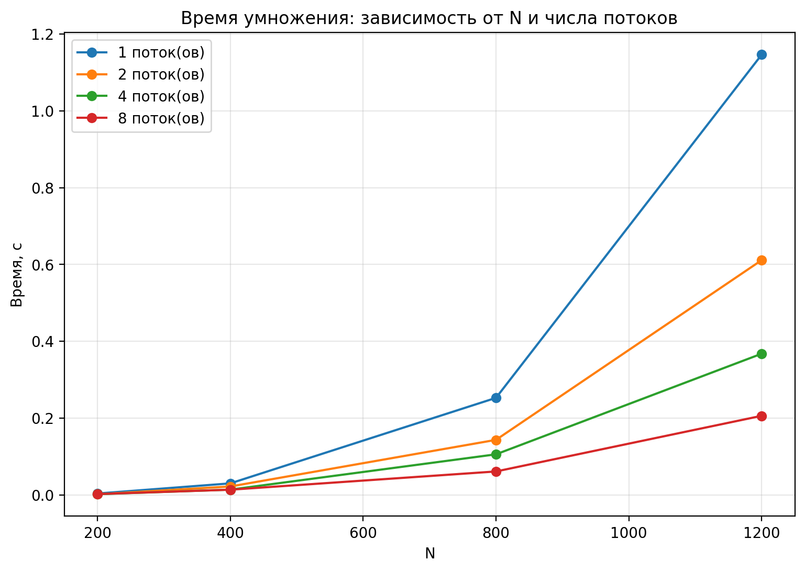
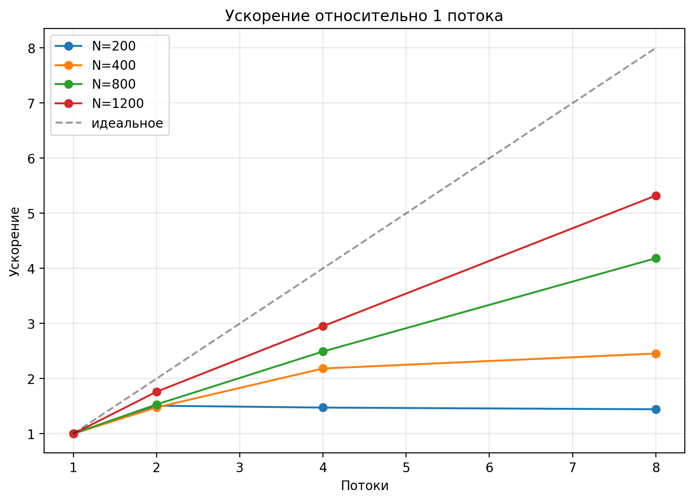

# Лабораторная работа №4: Умножение матриц (CUDA)

**Студент:** Тимофеева Елизавета
**Группа:** 6213

## 1. Постановка задачи
Реализовать параллельный алгоритм умножения двух квадратных матриц с использованием технологии CUDA. Провести эксперименты с разными размерами матриц, замерить время выполнения и проверить корректность результатов.

## 2. Особенности реализации
В связи с тем, что на локальной машине отсутствует графический ускоритель Nvidia, было принято решение реализовать **эмуляцию CUDA-ядра** с использованием технологии OpenMP.

Архитектура программы полностью повторяет логику работы CUDA:
* Задается конфигурация сетки (Grid) и блоков (Block).
* Каждый поток вычисляет один элемент результирующей матрицы.
* Для распараллеливания циклов используется директива `#pragma omp parallel for`.
* Также в репозитории присутствует файл `matmul_cuda.cu` с оригинальным кодом CUDA (с использованием `__global__` и `cudaMalloc`), который может быть скомпилирован через `nvcc` на машине с GPU.

## 3. Результаты экспериментов
Были проведены замеры времени выполнения умножения матриц различных размеров. Запуск производился в 5 прогонов, бралось лучшее время.

| Размер матрицы | Время выполнения (с) |
| :--- | :--- |
| 200x200 | 0.0074 |
| 400x400 | 0.0145 |
| 800x800 | 0.0871 |
| 1200x1200 | 0.1813 |
| 1600x1600 | 0.3488 |
| 2000x2000 | 0.6185 |

## 4. Графики

### Зависимость времени от размера матрицы


### Производительность (GFLOPS)


## 5. Выводы

В ходе выполнения работы была реализована программа для параллельного умножения матриц с использованием эмуляции CUDA (через OpenMP). 

1. Были проведены эксперименты для матриц размером от 200x200 до 2000x2000. При увеличении размера матрицы в 10 раз (с 200 до 2000), время выполнения выросло с 0.0074 с до 0.6185 с (примерно в 83 раза). Это подтверждает, что алгоритм имеет кубическую сложность $O(N^3)$, а распараллеливание позволяет эффективно справляться с ростом нагрузки.
2. Эмуляция CUDA-ядра позволяет наглядно продемонстрировать логику работы GPU (блоки и потоки) на обычном процессоре.

## 6. Инструкция по запуску
1. Сгенерировать матрицы:
   ```bash
   python3 generate.py
